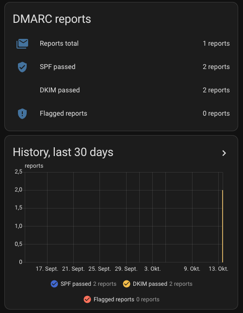

# DMARC Report Viewer add-on for Home Assistant

Do you own a domain and get strange mails from Google, Microsoft, Yahoo or other providers, each with an XML, zip
or gz attachment and a subject like `Report domain: example.com`? Those are DMARC reports. They tell you who sends
mail in the name of your domain and whether that mail passes SPF and DKIM, but nobody wants to read the XML by hand.
If you run Home Assistant OS or a Supervised installation (add-ons need the Supervisor), this add-on is for you:
install it, point it at the mailbox folder once, and from then on the reports turn into sensors, a dashboard and an
alert without any further work.

Home Assistant add-on that wraps [cry-inc/dmarc-report-viewer](https://github.com/cry-inc/dmarc-report-viewer).
It reads [DMARC](https://dmarc.org/overview/) aggregate reports (XML, zip or gz attachments, see
[RFC 7489](https://www.rfc-editor.org/rfc/rfc7489)) from a folder of an IMAP mailbox and provides a summary
that Home Assistant can turn into sensors, alerts and a dashboard. Everything stays on your network: no
third-party report service is involved.

The viewer is compiled from a pinned upstream commit
([`5e53bf8`](https://github.com/cry-inc/dmarc-report-viewer/commit/5e53bf879dac6c5b9cb93d3f89484cca8ecb38dd),
set as `COMMIT` in [`dmarc-viewer/Dockerfile`](dmarc-viewer/Dockerfile)), so you can review exactly what you run.

## Install

1. Click the button above, or add `https://github.com/waffel/ha-addon-dmarc-viewer` manually under
   Settings -> Add-ons -> Add-on store -> menu (three dots) -> Repositories
   ([how add-on repositories work](https://www.home-assistant.io/addons/)).
2. Install "DMARC Report Viewer". The first build compiles Rust and takes a while on a Raspberry Pi.
3. Prepare the mailbox: create a folder (default `DMARC-Reports`) and a mail filter that moves incoming DMARC
   report mails into it, for example subject contains `Report domain`.
4. Fill in the add-on configuration (see [`dmarc-viewer/DOCS.md`](dmarc-viewer/DOCS.md)) and start it. The sensors appear in Home Assistant a few minutes later.

## Sensors, dashboard and alert

The add-on creates the sensors itself (`sensor.dmarc_reports_total`, `sensor.dmarc_spf_passed`,
`sensor.dmarc_dkim_passed`, `sensor.dmarc_reports_flagged`). See [`dmarc-viewer/DOCS.md`](dmarc-viewer/DOCS.md).

| File | Purpose | Home Assistant docs |
|---|---|---|
| [`examples/dashboard-card.yaml`](examples/dashboard-card.yaml) | Card with current values and a 30 day history. Dashboard -> Edit -> Add card -> Manual | [dashboards](https://www.home-assistant.io/dashboards/) |
| [`blueprints/automation/dmarc_flagged_alert.yaml`](blueprints/automation/dmarc_flagged_alert.yaml) | Alert when the number of flagged reports increases | [blueprints](https://www.home-assistant.io/docs/automation/using_blueprints/) |

## Contributing and security

See [CONTRIBUTING.md](CONTRIBUTING.md) and [SECURITY.md](SECURITY.md). Changes are listed in
[CHANGELOG.md](CHANGELOG.md).

## License

MIT, see [LICENSE](LICENSE). The wrapped viewer is MIT licensed by its authors.
